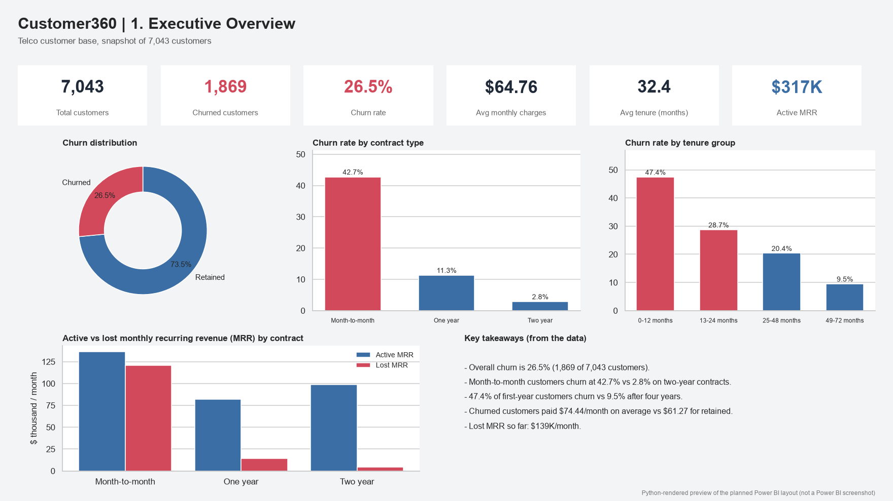
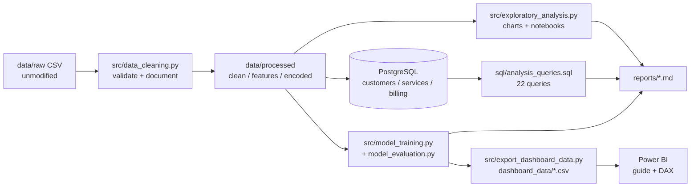
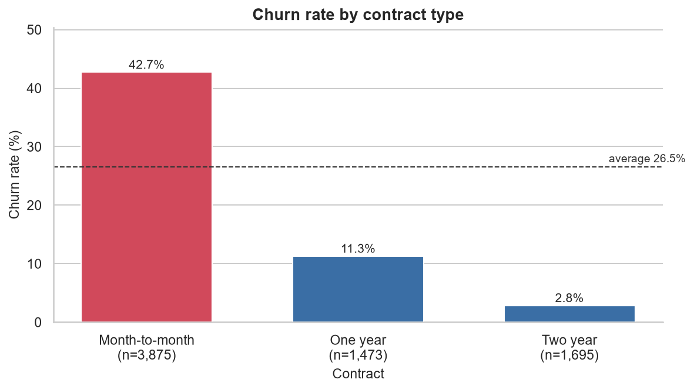
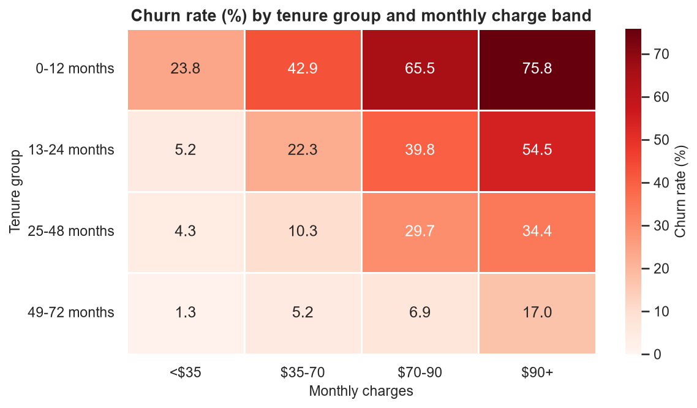
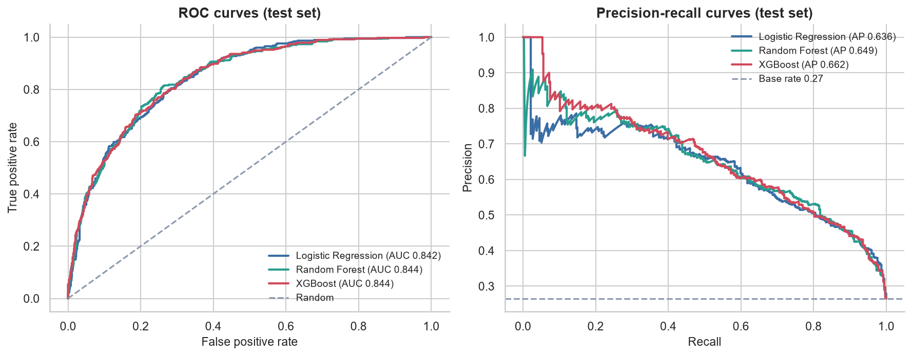
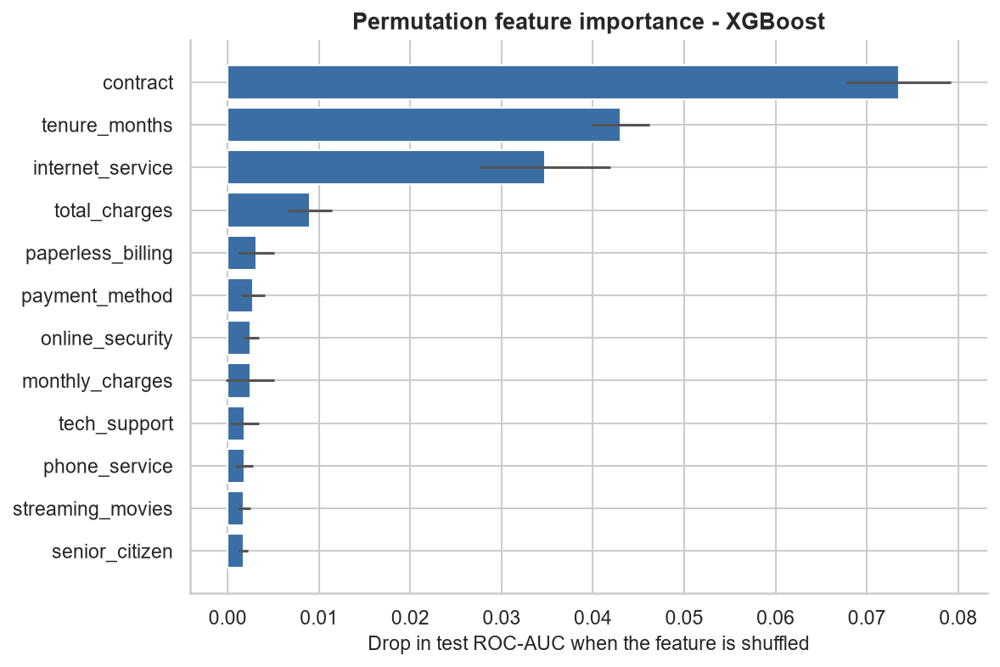
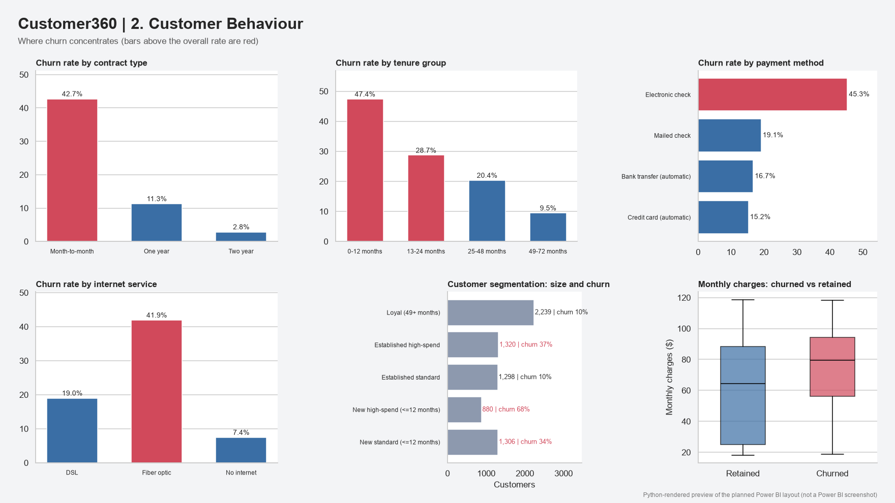
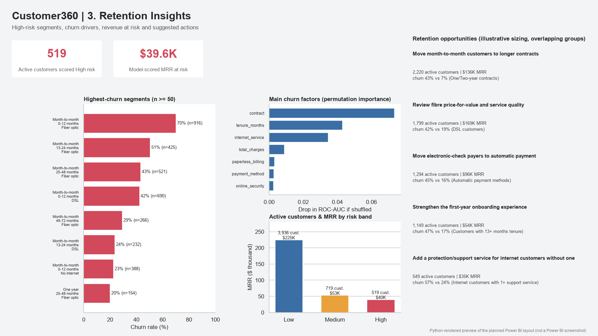

# Customer360 - Customer Retention & Churn Analytics

End-to-end churn analytics on the IBM Telco Customer Churn dataset: **Python + pandas, PostgreSQL + SQL, scikit-learn / XGBoost, and a Power BI-ready dashboard package**,
with a business report, 100 automated tests and a reproducible pipeline.

> **Version 1.0 - Core Analytics Release.** Phase 1 (core project) is complete and tested. Phase 2 features are listed in the [roadmap](#19-phase-2-roadmap-not-implemented-yet) and are **not** implemented yet.

| | |
|---|---|
| **Headline** | 26.5% of 7,043 customers churned; month-to-month + fibre + first-year customers churn at **70.2%** and account for ~1/3 of all churn |
| **Best model** | XGBoost, hold-out ROC-AUC **0.844** (logistic regression: 0.842 - models are statistically tied) |
| **SQL** | 22 analysis queries (JOINs, CTEs, window functions, ROLLUP) + 12 data-validation checks on PostgreSQL 16 |
| **Tests** | 100 pytest tests, all passing (SQL results cross-checked against pandas) |
| **Power BI** | Data model, DAX and build guide are included; **the `.pbix` file itself is not** (see [section 13](#13-power-bi-dashboard)) |


_Python-rendered preview of the planned Power BI page 1 - not a Power BI screenshot._

## Contents
1. [Overview](#1-project-overview) - 2. [Business problem](#2-business-problem) - 3. [Objectives](#3-project-objectives) - 4. [Dataset](#4-dataset-and-attribution) - 5. [Technologies](#5-technologies) - 6. [Architecture](#6-project-architecture) - 7. [Folder structure](#7-folder-structure) - 8. [Data cleaning](#8-data-cleaning-methodology) - 9. [EDA](#9-exploratory-data-analysis) - 10. [SQL](#10-sql-analysis) - 11. [ML method](#11-machine-learning-methodology) - 12. [Results](#12-model-evaluation-results) - 13. [Power BI](#13-power-bi-dashboard) - 14. [Insights](#14-business-insights) - 15. [Setup](#15-setup-and-execution) - 16. [Screenshots](#16-screenshots) - 17. [Limitations](#17-project-limitations) - 18. [v1.0 features](#18-version-10---completed-features) - 19. [Roadmap](#19-phase-2-roadmap-not-implemented-yet)

## 1. Project overview
Customer360 analyses why subscription customers leave and which ones are at risk. It cleans the raw data with documented decisions, explores it in Python,
loads it into PostgreSQL for SQL analysis, trains and honestly evaluates churn models, and prepares a three-page Power BI dashboard package and a business report.

## 2. Business problem
Churn is costly for subscription businesses. The project answers: why customers stop, which segments churn most, which services and contract types are involved,
how tenure and price matter, which customers are at higher risk, and what actions could improve retention.

## 3. Project objectives
- Clean and validate the data, recording every decision.
- Quantify churn by contract, tenure, internet service, payment method, price, seniority and support services.
- Build a PostgreSQL schema and at least 20 meaningful SQL queries.
- Train and compare Logistic Regression, Random Forest and XGBoost without data leakage; explain metrics beyond accuracy.
- Provide Power BI-ready data, DAX and layouts; write actionable, evidence-based recommendations.

## 4. Dataset and attribution
**IBM Telco Customer Churn** sample dataset (7,043 customers x 21 columns) - <https://www.kaggle.com/datasets/blastchar/telco-customer-churn>.
The data are sample/fictional customers of a telecom company published by IBM; credit to IBM and the Kaggle dataset publisher (`blastchar`). Check the original licence before reusing.

The Kaggle download requires a login, so `data/raw/WA_Fn-UseC_-Telco-Customer-Churn.csv` was obtained from IBM's public GitHub mirror
(<https://github.com/IBM/telco-customer-churn-on-icp4d>). It has the same schema and row count; it was **not byte-compared** with the Kaggle file. The raw file is unmodified
(SHA-256 recorded in [`data/raw/README.md`](data/raw/README.md) and verified by a test). Manual-download instructions are in the same file.

## 5. Technologies
Python 3.11 - pandas, NumPy, SciPy - Matplotlib, Seaborn - scikit-learn, XGBoost - PostgreSQL 16 (Docker Compose), SQLAlchemy, psycopg2 - Jupyter - Pytest - Power BI (guide + data package) - Git/GitHub.
Plotly and SHAP are in the project plan; SHAP is a Phase 2 item and is not used in v1.0.

## 6. Project architecture


## 7. Folder structure
```text
Customer360/
├── data/raw/                  original IBM CSV (+ provenance README)
├── data/processed/            clean, feature-engineered and encoded datasets
├── notebooks/                 01_data_exploration, 02_customer_churn_analysis (executed)
├── sql/                       schema.sql, validation_queries.sql, analysis_queries.sql
├── src/                       data_cleaning, feature_engineering, exploratory_analysis,
│                              model_training, model_evaluation, load_to_postgres,
│                              run_sql_analysis, export_dashboard_data, render_dashboard_preview
├── dashboard/                 powerbi_guide.md, dashboard_data/*.csv
├── reports/                   business_insights.md, model_results.md, data_cleaning_report.md,
│                              figures/, tables/, sql_results/
├── tests/                     100 pytest tests
├── docs/images/               dashboard previews
├── docker-compose.yml  .env.example  requirements.txt  .gitignore
```

## 8. Data cleaning methodology
Full log: [`reports/data_cleaning_report.md`](reports/data_cleaning_report.md) (generated by code).
- **Blank `TotalCharges`:** 11 blank strings (invisible to `isna()`), all customers with tenure 0 who have not been billed - set to 0.0, rows kept.
- No duplicate rows or IDs; no missing values besides the blanks; labels consistent.
- Redundant levels (`No internet service`, `No phone service`) mapped to `No`; `SeniorCitizen` 0/1 -> Yes/No; snake_case column names; `churn_flag` target added.
- Range and consistency rules validated in code (tenure 0-72, charges > 0, add-ons only with internet...). Cleaned data reconciles to the raw file (counts and charge totals).
- Engineered (row-local, leakage-free) features: tenure group, charge band, add-on / support counts, auto-pay flag, household flag, average monthly spend. Encoded numeric export provided.

## 9. Exploratory data analysis
18 charts in [`reports/figures/`](reports/figures) and an executed notebook with *what / why / action* interpretations for each finding ([`notebooks/02_customer_churn_analysis.ipynb`](notebooks/02_customer_churn_analysis.ipynb)).

| Dimension | Churn rate |
|---|---|
| Overall | **26.5%** (1,869 / 7,043) |
| Contract: month-to-month / one year / two year | **42.7%** / 11.3% / 2.8% |
| Tenure: 0-12 / 13-24 / 25-48 / 49-72 months | **47.4%** / 28.7% / 20.4% / 9.5% |
| Internet: fibre / DSL / none | **41.9%** / 19.0% / 7.4% |
| Payment: electronic check vs other methods | **45.3%** vs 15.2-19.1% |
| Monthly charges: <$35 / $35-70 / $70-90 / $90+ | 10.9% / 23.7% / **38.0%** / 32.9% |
| Senior citizen: yes / no | **41.7%** / 23.6% |
| Internet customers with / without tech support | 15.2% / **41.6%** |




## 10. SQL analysis
PostgreSQL schema ([`sql/schema.sql`](sql/schema.sql)): `customers`, `services`, `billing` (primary/foreign keys, CHECK constraints, typed columns), a `tenure_bands` lookup and a `customer_360` view.
[`sql/validation_queries.sql`](sql/validation_queries.sql) runs 12 integrity checks on load. [`sql/analysis_queries.sql`](sql/analysis_queries.sql) holds **22 commented queries** (total customers, churn rate, churn by contract / payment / internet,
averages by churn status, segmentation, high-value deciles, tenure retention, service combinations, MRR analysis, relative-risk groups, seniors, paperless billing, revenue at risk, CLV estimate, retention opportunities,
ROLLUP, segment ranking with Pareto share, watch-list, add-on depth). Results are exported to [`reports/sql_results/`](reports/sql_results). Examples of actual output:

| Query | Result |
|---|---|
| Q12 MRR | Active MRR $316,986; lost MRR $139,131 (month-to-month has lost 47% of its MRR) |
| Q16 Revenue exposure | 1,248 active customers in profiles with >=40% historical churn bill $99K/month (31% of active MRR) - an exposure measure, not a forecast |
| Q17 CLV (estimate) | 60-month CLV about $2.1K (month-to-month) vs $3.6K (one/two-year) under stated assumptions |
| Q20 Segment ranking | Month-to-month + fibre + 0-12 months: 70.2% churn, 34.7% of segment churners |

## 11. Machine learning methodology
- Features: 20 columns (tenure, charges, add-on count, services, contract, billing, demographics); ID and target excluded by construction (tested).
- Stratified 80/20 split (seed 42); test set untouched until final evaluation; **5-fold stratified CV on the training set** for selection.
- `Pipeline`s (one-hot encoding, scaling for logistic regression) re-fitted inside every CV fold - no leakage. A shuffled-label test confirms chance-level AUC.
- Models: Logistic Regression (baseline), Random Forest, XGBoost; each **unweighted and class-weighted** (churn is 26.5%) so imbalance handling is measured, not assumed.
- Champion = highest mean CV ROC-AUC; decision threshold chosen on **out-of-fold training predictions only**.
- Importance: permutation importance (on original columns) and logistic-regression odds ratios. Hyper-parameters are fixed; tuning is Phase 2.

## 12. Model evaluation results
Hold-out test set (1,409 customers), threshold 0.5. Source: [`reports/model_results.md`](reports/model_results.md).

| Model | Accuracy | Precision | Recall | F1 | ROC-AUC |
|---|---|---|---|---|---|
| Majority-class baseline (predict nobody churns) | 0.735 | 0.000 | 0.000 | 0.000 | 0.500 |
| Logistic Regression | 0.805 | 0.656 | 0.556 | 0.602 | 0.842 |
| Logistic Regression (balanced) | 0.739 | 0.505 | 0.786 | 0.615 | 0.842 |
| Random Forest | 0.797 | 0.649 | 0.513 | 0.573 | 0.844 |
| Random Forest (balanced) | 0.769 | 0.549 | 0.725 | 0.624 | 0.843 |
| XGBoost | 0.803 | 0.663 | 0.521 | 0.584 | 0.844 |
| XGBoost (balanced) | 0.747 | 0.516 | 0.791 | 0.624 | 0.843 |

- **Accuracy alone is not enough:** doing nothing scores 73.5% accuracy and finds no churners. Unweighted XGBoost has 80% accuracy but misses 48% of churners; weighting lifts recall to 79% at a precision cost.
- Models are **tied on ranking quality** (CV ROC-AUC 0.844-0.847, std ~0.01). XGBoost was chosen by the pre-set rule; logistic regression is equally good and more explainable.
- Threshold 0.32 (chosen on training data): precision 53.5%, recall 74.3%, F1 0.62.
- **Targeting:** top 10% of customers by risk contain 29% of churners (lift 2.9x); top 30% contain 66%.
- **Drivers:** contract, tenure and internet service dominate (then total charges, billing and payment attributes).




## 13. Power BI dashboard
**Honest status:** Power BI Desktop could not be automated in the development environment. **No `.pbix` is included.** What is delivered:
- Star-schema data package in [`dashboard/dashboard_data/`](dashboard/dashboard_data) (fact table with out-of-fold risk scores, dimensions, segment / importance / opportunity tables, KPI reconciliation file) - tested against the raw data.
- [`dashboard/powerbi_guide.md`](dashboard/powerbi_guide.md): load steps, relationships, **DAX measures**, theme, visual-by-visual layouts for the 3 pages (Executive Overview, Customer Behaviour, Retention Insights) and expected KPI values.
- Python-rendered **previews** of the three pages (labelled as such) generated from the same files.

| Executive Overview | Customer Behaviour | Retention Insights |
|---|---|---|
|  |  |  |

## 14. Business insights
Full report: [`reports/business_insights.md`](reports/business_insights.md). Highlights:
- **Where:** month-to-month contracts (89% of churners), fibre (69%), first-year customers (55% of churners leave within 12 months), electronic-check payers, customers with no support service, new high-spend customers (68% churn).
- **Priority pilot:** new month-to-month fibre customers - 916 customers, 70.2% churn, about a third of all churn.
- **Levers (sized on active customers, overlapping, associations not causal effects):** longer contracts (2,220 active, $136K MRR), fibre price-for-value review (1,799, $169K), auto-pay switch (1,294, $96K), first-year onboarding (1,149, $54K), support-service bundles (549, $35K).
- Measure every campaign against a holdout group before budgeting.

## 15. Setup and execution
Requires Python 3.11+, Git and Docker (for PostgreSQL). Windows PowerShell shown; adapt activation for macOS/Linux.

```powershell
git clone https://github.com/TanviC1314/Customer360-Customer-Retention-Analytics.git
cd Customer360-Customer-Retention-Analytics
python -m venv .venv
.venv\Scripts\activate
pip install -r requirements.txt
copy .env.example .env          # then set a local POSTGRES_PASSWORD in .env
```

Run the pipeline in order (each step is idempotent):

```powershell
python -m src.data_cleaning            # data/processed/telco_churn_clean.csv + reports/data_cleaning_report.md
python -m src.feature_engineering      # features + encoded datasets
python -m src.exploratory_analysis     # 18 EDA charts + reports/eda_summary.json
docker compose up -d                   # PostgreSQL 16 on host port 5434
python -m src.load_to_postgres         # schema + load + 12 validation checks
python -m src.run_sql_analysis --export   # run the 22 queries, export CSVs
python -m src.model_training           # CV + fit (models/ is gitignored)
python -m src.model_evaluation         # test metrics, charts, reports/model_results.md
python -m src.export_dashboard_data    # dashboard/dashboard_data/*.csv
python -m src.render_dashboard_preview # docs/images previews
python -m pytest                       # 100 tests (database tests skip if PostgreSQL is not running)
```

Notebooks: `jupyter lab notebooks/`. Credentials come only from `.env` (gitignored); `.env.example` is committed. Port 5434 avoids clashes with other local Postgres containers - change `POSTGRES_PORT` if needed.

## 16. Screenshots
No GUI application is shipped; the visual deliverables are the charts, executed notebooks and dashboard previews above. All images are generated by the code in this repository.
A real Power BI screenshot will be added when the `.pbix` is built from the guide.

## 17. Project limitations
- Single snapshot without dates: no trend, survival modelling or time-based validation; revenue figures are monthly-charge (MRR) based.
- Associations, not causal effects; correlated drivers (contract, tenure, support services) overlap. Opportunity sizes are illustrative.
- Models: one split + CV, fixed hyper-parameters, uncalibrated probabilities, no cost data for the threshold; model differences are within noise.
- CLV and revenue-at-risk figures use simple, stated assumptions and are not forecasts.
- Public sample dataset obtained from a mirror (not byte-compared with the Kaggle file); results illustrate the method.
- No `.pbix` file yet; previews are Python renderings.

## 18. Version 1.0 - completed features
- [x] Data cleaning with documented decisions, validation and reconciliation
- [x] Feature engineering (leakage-safe) and encoded dataset
- [x] EDA: 18 charts, executed notebooks, interpretations
- [x] PostgreSQL schema, loader, 12 validation checks, 22 SQL queries
- [x] Logistic Regression / Random Forest / XGBoost with CV, imbalance handling, full metrics, feature importance, threshold selection, lift
- [x] Power BI data package, DAX, build guide and previews (no `.pbix`)
- [x] Business insights and model reports (generated from executed results)
- [x] 100 automated tests (cleaning, features, model inputs, SQL vs pandas, dashboard reconciliation)

## 19. Phase 2 roadmap

| # | Enhancement | Status |
|---|---|---|
| 1 | Customer segmentation with K-Means | ✅ Done – `src/segmentation.py`, 10 tests, k=5 (silhouette 0.34), report and figures in `reports/`, dashboard CSVs in `dashboard/dashboard_data/` |
| 2 | Advanced churn prediction with hyper-parameter tuning | ✅ Done – `src/model_tuning.py`, 7 tests, `RandomizedSearchCV` (30 iter, 5-fold), report in `reports/tuning_results.md` |
| 3 | More detailed feature-importance analysis | pending |
| 4 | SHAP-based model explanations | pending |
| 5 | Individual customer churn-risk explanations | pending |
| 6 | Customer lifetime value prediction | pending |
| 7 | Retention campaign recommendation engine | pending |
| 8 | More advanced customer segmentation dashboard | pending |
| 9 | Automated data refresh pipeline | pending |
| 10 | Scheduled reporting and analytics | pending |

### Phase 2, item 1 — K-Means segmentation results (k=5, silhouette 0.34)

| Segment | Customers | Churn rate | Share of churners | Avg tenure | Avg monthly | Active MRR |
|---|---|---|---|---|---|---|
| New mid-spend, month-to-month, manual pay | 1,803 | 40.9% | 39.4% | 10.4 mo | $60 | $63,787 |
| Established high-spend, month-to-month, manual pay | 1,513 | 40.5% | 32.8% | 36.6 mo | $91 | $81,985 |
| Established mid-spend, month-to-month, auto-pay | 1,251 | 30.6% | 20.4% | 34.5 mo | $64 | $55,636 |
| Long-standing high-spend, contracted, auto-pay | 1,502 | 7.9% | 6.3% | 65.0 mo | $80 | $110,948 |
| Long-standing low-spend, contracted | 974 | 1.8% | 0.9% | 69.3 mo | $24 | $22,836 |

A silhouette of 0.34 indicates weak-to-moderate separation; segments are useful summaries, not sharply distinct natural groups.
See `reports/segmentation_results.md` for the full report.
