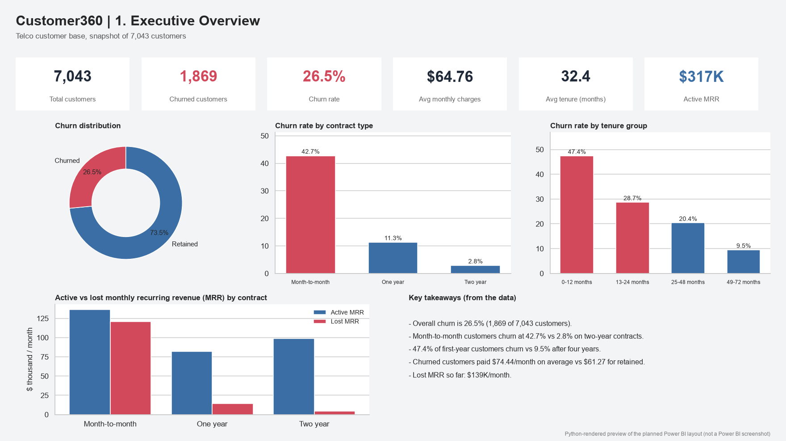
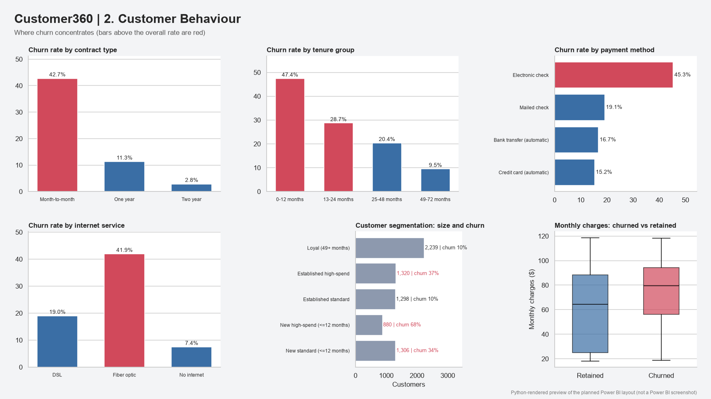
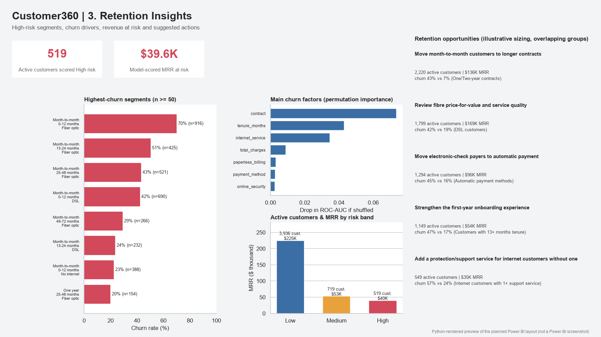

# Power BI dashboard guide

> **Status - read this first.** Power BI Desktop is a Windows GUI application and could not be automated in the
> development environment, so **no `.pbix` file is included and none is claimed.** What *is* included and verified:
> (1) Power BI-ready data files in [`dashboard_data/`](dashboard_data), (2) the exact DAX measures, relationships and page
> layouts below, and (3) static PNG previews of the three pages rendered from the same files with Python
> (`src/render_dashboard_preview.py`) so you can see the intended result and check your numbers.
> Building the report from this guide takes roughly 45-60 minutes.

Previews (Python/Matplotlib renderings of the planned layout, **not Power BI screenshots**):

| Page 1 - Executive Overview | Page 2 - Customer Behaviour | Page 3 - Retention Insights |
|---|---|---|
|  |  |  |

---

## 1. Data files (`dashboard/dashboard_data/`)

Regenerate any time with `python -m src.export_dashboard_data` (needs the trained model metrics from `python -m src.model_evaluation`).

| File | Grain / rows | Use |
|---|---|---|
| `customers.csv` | 1 row per customer (7,043) | **Fact table.** Demographics, services, billing, engineered features, `churn_flag`, `customer_segment`, out-of-fold `churn_risk_score`, `risk_band`, `monthly_revenue_at_risk` |
| `dim_tenure_group.csv`, `dim_charge_band.csv`, `dim_contract.csv`, `dim_risk_band.csv`, `dim_segment.csv` | 3-5 rows each | Sort-order dimension tables so categories appear in logical order |
| `segment_summary.csv` | contract x tenure x internet segments with n >= 50 (27 rows) | Page 3 "high-risk segments" table |
| `feature_importance.csv` | one row per model feature | Page 3 "main churn factors" (permutation importance of the champion model) |
| `retention_opportunities.csv` | 5 rows | Page 3 opportunity table with suggested actions |
| `kpi_summary.csv` | 1 row | **Reconciliation only** - compare your DAX results against it |
| `model_comparison.csv` | 7 rows | Optional model-performance table |

Notes on the risk fields: `churn_risk_score` is an **out-of-fold** probability from the champion model (each customer is scored by a model
that never saw that customer). `risk_band`: Low < 0.30, Medium 0.30-0.50, High >= 0.50 (thresholds are a presentation choice).
`monthly_revenue_at_risk` is the monthly charge of customers who are **still active and scored High** - an exposure measure, not a forecast of actual loss.

## 2. Load the data

1. **Home > Get data > Text/CSV**, load all `.csv` files above (or **Get data > Folder** and expand). Keep column types as detected,
   then check that `monthly_charges`, `total_charges`, `churn_risk_score`, `monthly_revenue_at_risk` are *Decimal* and the `*_order`, `churn_flag`, `tenure_months` columns are *Whole number*.
2. Optional - load straight from PostgreSQL instead: **Get data > PostgreSQL database**, server `localhost:5434`, database `customer360`,
   table/view `customer_360` (credentials from your local `.env`). The CSV route is needed for the model scores, which live only in `customers.csv`.
3. **Model view** - create these many-to-one (single direction) relationships from the fact table to the dimensions:

   | From (many) | To (one) |
   |---|---|
   | `customers[tenure_group]` | `dim_tenure_group[tenure_group]` |
   | `customers[monthly_charge_band]` | `dim_charge_band[monthly_charge_band]` |
   | `customers[contract]` | `dim_contract[contract]` |
   | `customers[risk_band]` | `dim_risk_band[risk_band]` |
   | `customers[customer_segment]` | `dim_segment[customer_segment]` |

   `segment_summary`, `feature_importance`, `retention_opportunities`, `kpi_summary` and `model_comparison` stay unrelated (stand-alone tables).
4. **Sort by column** (Column tools > Sort by column): `dim_tenure_group[tenure_group]` by `sort_order`; same for the other four dimensions.
   Slicers and axes should use the dimension columns so they sort correctly.

## 3. DAX measures

Create a blank table `_Measures` (Enter data) and add the measures there. `customers` is the fact table.

```dax
-- Core counts
Total Customers        = DISTINCTCOUNT ( customers[customer_id] )
Churned Customers      = CALCULATE ( [Total Customers], customers[churn_flag] = 1 )
Active Customers       = CALCULATE ( [Total Customers], customers[churn_flag] = 0 )

-- Rates
Churn Rate %           = DIVIDE ( [Churned Customers], [Total Customers] )
Retention Rate %       = 1 - [Churn Rate %]
Overall Churn Rate %   = CALCULATE ( [Churn Rate %], ALL ( customers ) )
Churn vs Overall (pts) = ( [Churn Rate %] - [Overall Churn Rate %] ) * 100
Customer Share %       = DIVIDE ( [Total Customers], CALCULATE ( [Total Customers], ALL ( customers ) ) )

-- Averages
Avg Monthly Charges            = AVERAGE ( customers[monthly_charges] )
Avg Tenure (Months)            = AVERAGE ( customers[tenure_months] )
Avg Monthly Charges (Churned)  = CALCULATE ( [Avg Monthly Charges], customers[churn_flag] = 1 )
Avg Monthly Charges (Retained) = CALCULATE ( [Avg Monthly Charges], customers[churn_flag] = 0 )

-- Revenue (MRR = sum of monthly plan charges; the dataset has no calendar dates)
Active MRR             = CALCULATE ( SUM ( customers[monthly_charges] ), customers[churn_flag] = 0 )
Lost MRR               = CALCULATE ( SUM ( customers[monthly_charges] ), customers[churn_flag] = 1 )
% MRR Lost             = DIVIDE ( [Lost MRR], SUM ( customers[monthly_charges] ) )

-- Risk (model scores are out-of-fold; see section 1)
High-Risk Active Customers = CALCULATE ( [Total Customers], customers[risk_band] = "High", customers[churn_flag] = 0 )
Revenue at Risk (MRR)      = SUM ( customers[monthly_revenue_at_risk] )
Revenue at Risk (Annualised) = [Revenue at Risk (MRR)] * 12
Revenue at Risk % of Active MRR = DIVIDE ( [Revenue at Risk (MRR)], [Active MRR] )
Avg Risk Score (Active)    = CALCULATE ( AVERAGE ( customers[churn_risk_score] ), customers[churn_flag] = 0 )

-- Conditional formatting helper (red when above the overall rate)
Churn Bar Colour       = IF ( [Churn Rate %] > [Overall Churn Rate %], "#D1495B", "#3A6EA5" )
```

**Reconciliation - your measures must return** (values from `kpi_summary.csv`, computed from the data):

| Measure | Expected |
|---|---|
| Total Customers | 7,043 |
| Churned Customers | 1,869 |
| Active Customers | 5,174 |
| Churn Rate % | 26.54% |
| Avg Monthly Charges | $64.76 |
| Avg Tenure (Months) | 32.37 |
| Active MRR | $316,985.75 |
| Lost MRR | $139,130.85 |
| High-Risk Active Customers | 519 |
| Revenue at Risk (MRR) | $39,605.45 |

If a value differs, check the column data types (section 2) first. `kpi_summary.csv` is also checked against the raw data by `pytest`.

## 4. Theme and conventions

* Canvas background `#F3F4F6`, cards/visual background white, font Segoe UI.
* Colours: churned / above-average churn `#D1495B`, retained / normal `#3A6EA5`, neutral `#8D99AE`, medium risk `#E9A23B`.
* Percentages with 1 decimal; currency `$#,0`; titles in sentence case, always say what the visual shows ("Churn rate by contract type").
* Use `Churn Bar Colour` for **Format > Columns > Colours > fx > Field value** so bars above the overall rate turn red.
* Add a text box on each page: "Source: IBM Telco Customer Churn sample dataset; snapshot of 7,043 customers. Associations, not proof of cause."

## 5. Page layouts (canvas 1280 x 720)

### Page 1 - Executive Overview

| Zone | Visual | Fields |
|---|---|---|
| Top row, 6 cards | Card x6 | `Total Customers`, `Churned Customers`, `Churn Rate %`, `Avg Monthly Charges`, `Avg Tenure (Months)`, `Active MRR` |
| Left, middle | Donut | Legend `customers[churn_status]`, Values `Total Customers` ("Churn distribution") |
| Centre | Clustered column | Axis `dim_contract[contract]`, Values `Churn Rate %`, colour by `Churn Bar Colour` |
| Right | Clustered column | Axis `dim_tenure_group[tenure_group]`, Values `Churn Rate %` |
| Bottom left | Clustered column | Axis `dim_contract[contract]`, Values `Active MRR`, `Lost MRR` |
| Bottom right | Text box / Smart narrative | Key takeaways |
| Left edge | Slicers (optional) | `gender`, `senior_citizen`, `internet_service` |

### Page 2 - Customer Behaviour

| Zone | Visual | Fields |
|---|---|---|
| Top left | Column | `dim_contract[contract]` x `Churn Rate %` |
| Top centre | Column | `dim_tenure_group[tenure_group]` x `Churn Rate %` |
| Top right | Bar (horizontal) | `customers[payment_method]` x `Churn Rate %`, sorted descending |
| Bottom left | Column | `customers[internet_service]` x `Churn Rate %` |
| Bottom centre | Clustered bar | `dim_segment[customer_segment]` x `Total Customers`; add `Churn Rate %` as a tooltip or a second visual (**customer segmentation**) |
| Bottom right | Box plot / or Clustered column | `churn_status` x `Avg Monthly Charges` (**monthly charges comparison**; for a true box plot install the free *Box and Whisker chart* custom visual) |
| Slicers | Dropdown | `contract`, `internet_service`, `senior_citizen`, `paperless_billing` - sync across pages 1-3 |
| Drill-through | Optional | Tooltip page showing `Customer Share %` and `Churn vs Overall (pts)` |

### Page 3 - Retention Insights

| Zone | Visual | Fields |
|---|---|---|
| Top row, 3 cards | Card | `High-Risk Active Customers`, `Revenue at Risk (MRR)`, `Revenue at Risk (Annualised)` |
| Left | Table / bar | `segment_summary[segment_label]`, `customers`, `churn_rate_pct`, `active_mrr` - Top N 8 by `churn_rate_pct` (**high-risk segments**) |
| Centre top | Bar | `feature_importance[feature]` x `importance_mean`, Top N 10 (**main churn factors**) |
| Centre bottom | Column | `dim_risk_band[risk_band]` x `Active MRR` with `Active Customers` as tooltip, filtered to active customers (**revenue at risk**) |
| Right | Table | `retention_opportunities[opportunity]`, `active_customers`, `active_mrr`, `target_churn_rate_pct`, `comparison_churn_rate_pct`, `suggested_action` (**retention opportunities and suggested actions**) |
| Footer | Text box | "Opportunity sizing is illustrative: groups overlap and gaps are observed associations, not causal effects." |

## 6. Publishing checklist

- [ ] Reconciliation table above matches.
- [ ] Every visual has a title; axes labelled; slicers synced.
- [ ] Page names: `1 Executive Overview`, `2 Customer Behaviour`, `3 Retention Insights`.
- [ ] Save as `dashboard/Customer360.pbix` and add real screenshots to `docs/images/` (replace the Python previews in the README).
- [ ] Do not publish to a shared workspace with customer IDs unless that is acceptable for your data policy (this dataset is a public sample).
