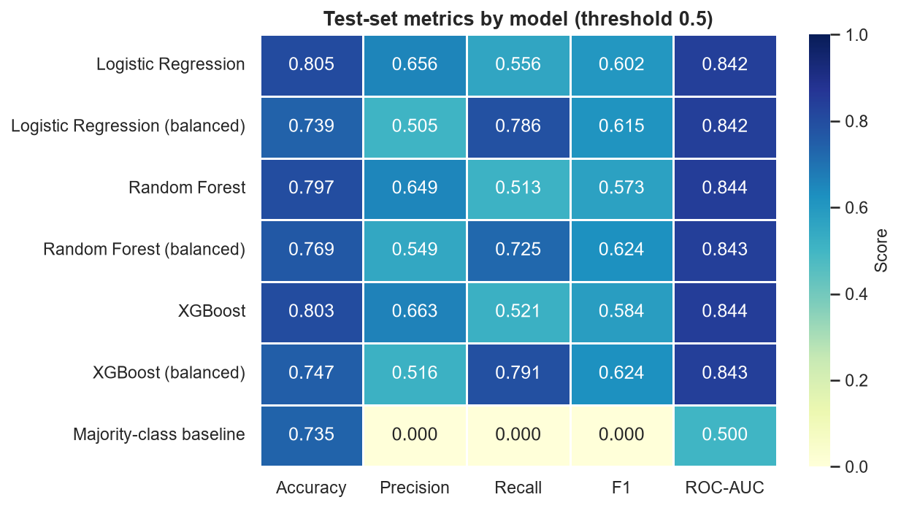
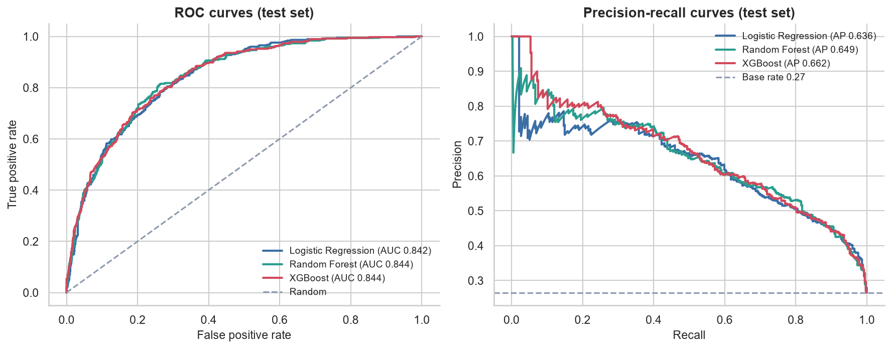
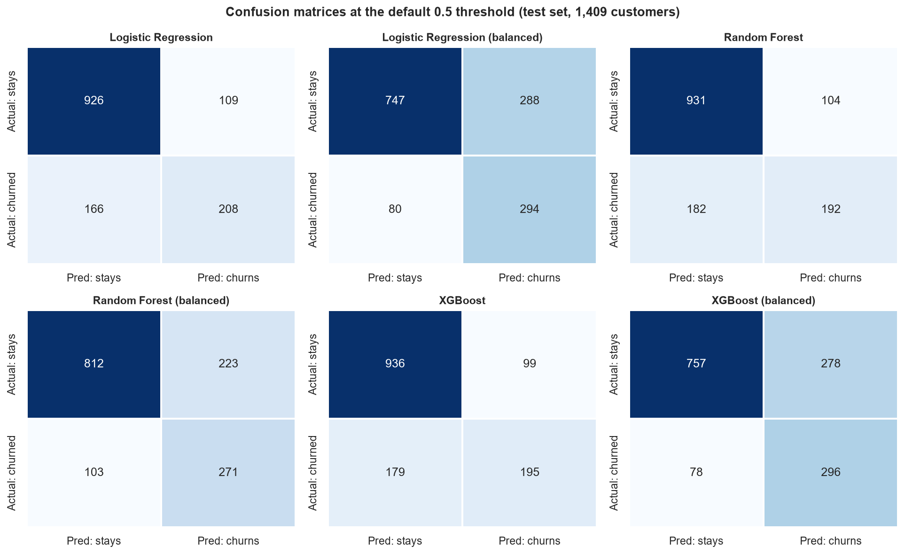
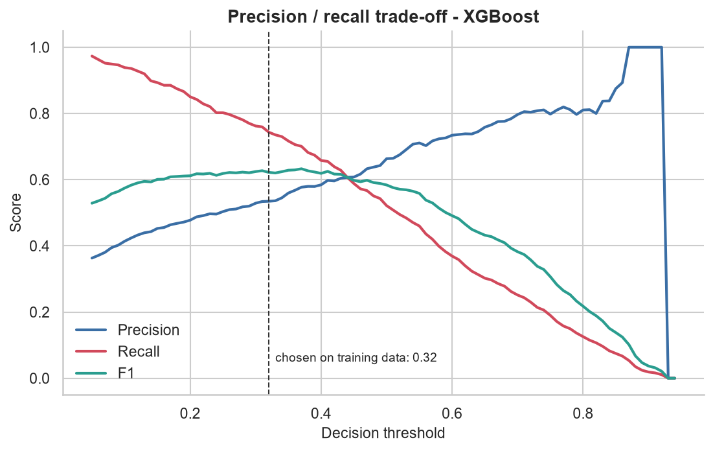
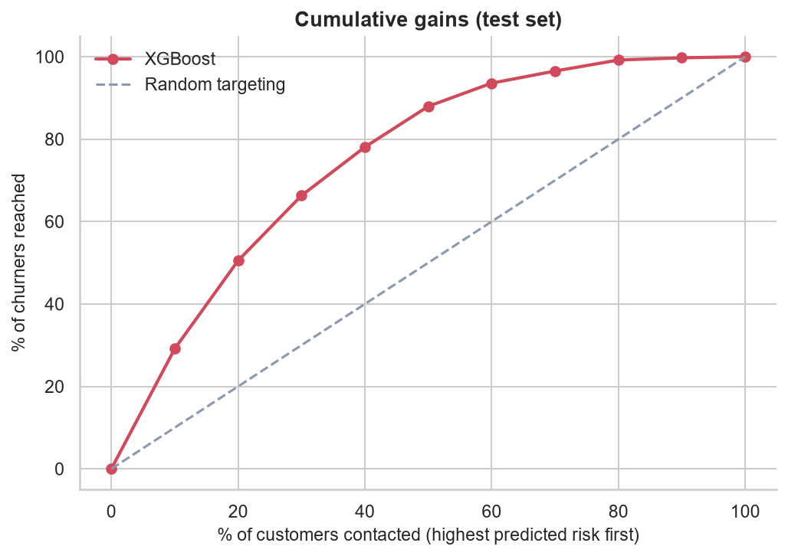
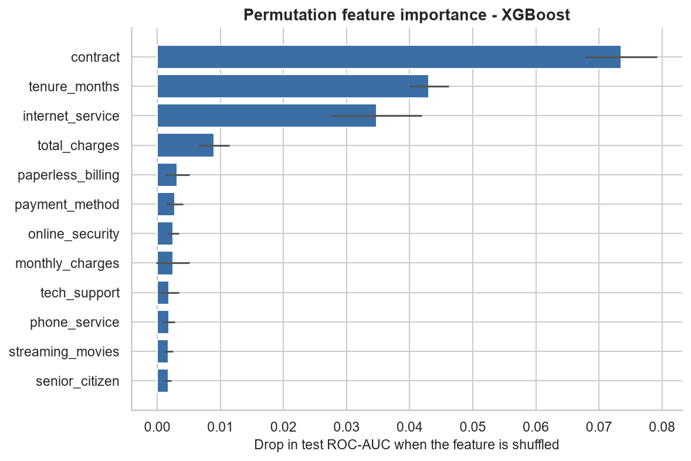
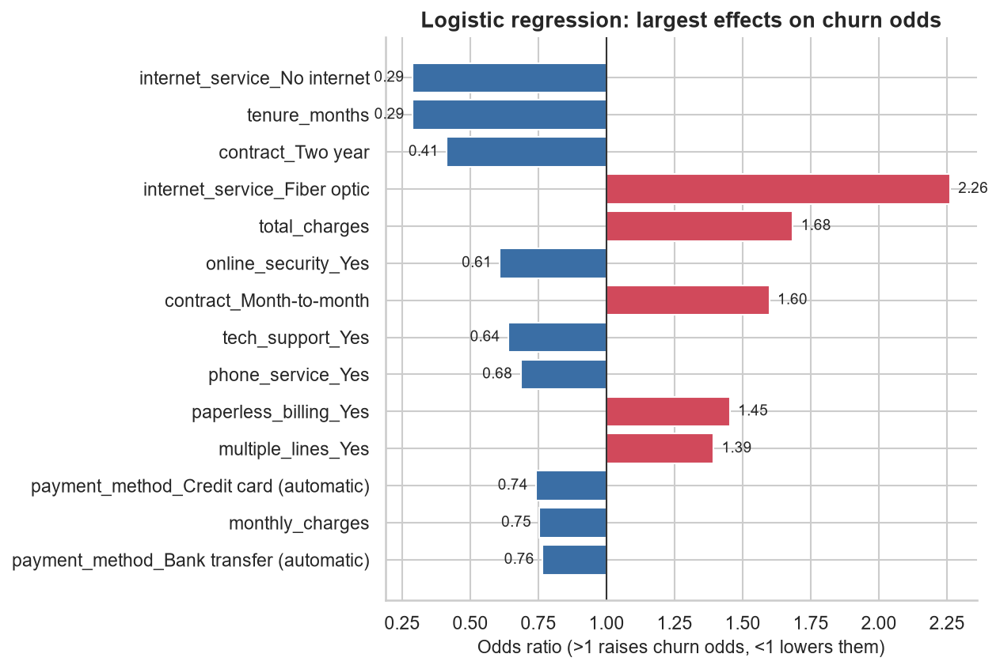

# Model results

_Generated by `python -m src.model_evaluation` from the executed models - every number below was computed, none typed in.
Random seed 42; hold-out test set = 1,409 customers (5,634 used for training and cross-validation)._

## 1. Setup

| Item | Choice |
|---|---|
| Target | `churn_flag` (1 = churned) - 26.5% of training customers churned |
| Split | Stratified 80/20 train/test (`random_state=42`); test set untouched until final evaluation |
| Preprocessing | `ColumnTransformer` inside every `Pipeline`: standard-scaling of numerics (logistic regression only; trees do not need it) and one-hot encoding of categoricals (`handle_unknown="ignore"`). Re-fitted inside each CV fold, so no leakage |
| Features | 20 raw columns (tenure, charges, services, contract, billing, demographics). `customer_id`, `churn` and `churn_flag` are excluded by construction (tested) |
| Models | Logistic Regression (baseline), Random Forest, XGBoost - each unweighted and with class weighting |
| Class imbalance | 26.5% positives. Class weighting is compared against unweighted training (below) rather than assumed |
| Model selection | 5-fold stratified CV on the training data only; champion = highest mean CV ROC-AUC |
| Hyper-parameters | Fixed, conservative values. Systematic tuning is a Phase 2 item, so these results are a starting point, not an optimum |

## 2. Cross-validation results (training data, mean ± std over 5 folds)

| Model | Accuracy | Precision | Recall | F1 | ROC-AUC |
|---|---|---|---|---|---|
| Logistic Regression | 0.803 ± 0.012 | 0.654 ± 0.028 | 0.544 ± 0.041 | 0.593 ± 0.030 | 0.846 ± 0.013 |
| Logistic Regression (balanced) | 0.749 ± 0.014 | 0.517 ± 0.017 | 0.803 ± 0.036 | 0.629 ± 0.021 | 0.846 ± 0.012 |
| Random Forest | 0.800 ± 0.014 | 0.667 ± 0.040 | 0.492 ± 0.023 | 0.566 ± 0.027 | 0.844 ± 0.010 |
| Random Forest (balanced) | 0.778 ± 0.010 | 0.563 ± 0.016 | 0.726 ± 0.034 | 0.634 ± 0.020 | 0.845 ± 0.010 |
| XGBoost | 0.803 ± 0.011 | 0.666 ± 0.030 | 0.520 ± 0.023 | 0.584 ± 0.023 | 0.847 ± 0.011 |
| XGBoost (balanced) | 0.753 ± 0.009 | 0.523 ± 0.012 | 0.792 ± 0.027 | 0.630 ± 0.015 | 0.847 ± 0.010 |

All six variants have CV ROC-AUC within 0.004 of each other, far less than the fold-to-fold standard deviation (~0.01).
**The models cannot be separated on ranking quality.** The champion rule (highest mean CV ROC-AUC) selects **XGBoost**, but the
choice is close to arbitrary; logistic regression is statistically indistinguishable and far easier to explain.

## 3. Hold-out test results (threshold 0.5)

| Model | Accuracy | Precision | Recall | F1 | ROC-AUC | PR-AUC | TP | FP | FN | TN |
|---|---|---|---|---|---|---|---|---|---|---|
| Logistic Regression | 0.805 | 0.656 | 0.556 | 0.602 | 0.842 | 0.636 | 208 | 109 | 166 | 926 |
| Logistic Regression (balanced) | 0.739 | 0.505 | 0.786 | 0.615 | 0.842 | 0.634 | 294 | 288 | 80 | 747 |
| Random Forest | 0.797 | 0.649 | 0.513 | 0.573 | 0.844 | 0.649 | 192 | 104 | 182 | 931 |
| Random Forest (balanced) | 0.769 | 0.549 | 0.725 | 0.624 | 0.843 | 0.649 | 271 | 223 | 103 | 812 |
| XGBoost | 0.803 | 0.663 | 0.521 | 0.584 | 0.844 | 0.662 | 195 | 99 | 179 | 936 |
| XGBoost (balanced) | 0.747 | 0.516 | 0.791 | 0.624 | 0.843 | 0.660 | 296 | 278 | 78 | 757 |
| Majority-class baseline | 0.735 | 0.000 | 0.000 | 0.000 | 0.500 | 0.265 | 0 | 0 | 374 | 1035 |

(TP/FP/FN/TN = confusion-matrix counts with "churn" as the positive class.)

### Why accuracy alone is not enough

* A "model" that predicts *nobody churns* scores **73.5% accuracy** on this test set while catching
  **0.0%** of churners. Accuracy mostly measures the majority class when only ~1 in 4 customers churns.
* Unweighted XGBoost has 80.3% accuracy but recall of only 52.1%: it misses about
  48% of customers who leave. The class-weighted version has *lower* accuracy
  (74.7%) but recall of 79.1% - it is more useful for retention, which is why
  the metrics must be read together.
* A missed churner (false negative) costs a customer's recurring revenue; a false alarm (false positive) costs a discount or a call.
  The right balance of precision and recall depends on those costs, which the dataset does not contain.
* ROC-AUC/PR-AUC are threshold-free and measure how well customers are *ranked* by risk, which is what targeting a limited
  retention budget needs.

Class weighting trades precision for recall at the default 0.5 threshold without changing the ranking quality
(ROC-AUC differs by < 0.01 between weighted and unweighted versions).

## 4. Champion model: XGBoost

* Test ROC-AUC **0.844** (range across all six variants: 0.842-0.844); PR-AUC 0.662.
* Threshold choice: the default 0.5 gives precision 66.3% / recall 52.1% / F1 0.584.
  A threshold of **0.32** was chosen to maximise F1 on *out-of-fold predictions for the training data only* (the
  test set played no part) and gives precision 53.5% / recall 74.3% /
  F1 0.622 / accuracy 76.0% on the test set.

| threshold | customers_flagged | precision | recall | f1 | accuracy |
|---|---|---|---|---|---|
| 0.200 | 666.000 | 0.477 | 0.850 | 0.612 | 0.713 |
| 0.300 | 539.000 | 0.529 | 0.762 | 0.624 | 0.757 |
| 0.320 | 520.000 | 0.535 | 0.743 | 0.622 | 0.760 |
| 0.400 | 421.000 | 0.584 | 0.658 | 0.619 | 0.785 |
| 0.500 | 294.000 | 0.663 | 0.521 | 0.584 | 0.803 |
| 0.600 | 188.000 | 0.734 | 0.369 | 0.491 | 0.797 |
| 0.700 | 118.000 | 0.797 | 0.251 | 0.382 | 0.784 |

### Targeting value (decile lift, test set)

Customers sorted by predicted churn risk. The top 10% of customers contain **29.1%** of all churners
(lift 2.9x); the top 30% contain **66.3%**.
(Random targeting would reach 10% and 30%.)

| Risk decile (1 = highest) | customers | churners | churn_rate | lift | cum_share_of_churners |
|---|---|---|---|---|---|
| 1 | 141 | 109 | 77.3% | 2.91 | 29.1% |
| 2 | 141 | 80 | 56.7% | 2.14 | 50.5% |
| 3 | 141 | 59 | 41.8% | 1.58 | 66.3% |
| 4 | 141 | 44 | 31.2% | 1.18 | 78.1% |
| 5 | 141 | 37 | 26.2% | 0.99 | 88.0% |
| 6 | 140 | 21 | 15.0% | 0.57 | 93.6% |
| 7 | 141 | 11 | 7.8% | 0.29 | 96.5% |
| 8 | 141 | 10 | 7.1% | 0.27 | 99.2% |
| 9 | 141 | 2 | 1.4% | 0.05 | 99.7% |
| 10 | 141 | 1 | 0.7% | 0.03 | 100.0% |

## 5. What drives churn (feature importance)

**Permutation importance** (XGBoost, test set, 10 repeats): how much ROC-AUC falls when one original column is randomly shuffled.
Computed on original columns, so the importance of a multi-level feature like `contract` is not split across dummy columns.

| Feature | ROC-AUC drop (mean) | Std |
|---|---|---|
| contract | 0.0735 | 0.0057 |
| tenure_months | 0.0430 | 0.0032 |
| internet_service | 0.0348 | 0.0071 |
| total_charges | 0.0090 | 0.0024 |
| paperless_billing | 0.0032 | 0.0019 |
| payment_method | 0.0028 | 0.0013 |
| online_security | 0.0025 | 0.0009 |
| monthly_charges | 0.0025 | 0.0026 |

**Logistic-regression odds ratios** (largest absolute effects; numeric features standardised, so their ratio is per +1 SD;
dummy features are per switch from 0 to 1, holding other features fixed):

| Encoded feature | Odds ratio |
|---|---|
| internet_service_No internet | 0.29 |
| tenure_months | 0.29 |
| contract_Two year | 0.41 |
| internet_service_Fiber optic | 2.26 |
| total_charges | 1.68 |
| online_security_Yes | 0.61 |
| contract_Month-to-month | 1.60 |
| tech_support_Yes | 0.64 |
| phone_service_Yes | 0.68 |
| paperless_billing_Yes | 1.45 |

Caution: correlated features share credit (e.g. `tenure_months`, `total_charges`, `contract`), and importance describes what the model
uses for prediction - it is **association, not proof of cause**.

## 6. Limitations

* Single snapshot, no dates: cannot validate over time or build time-to-churn / survival models.
* Single random split + CV: differences between models of ~0.01 AUC are inside the noise.
* No cost data (retention offer cost, margin), so thresholds are chosen on F1, not profit.
* Hyper-parameters not tuned; probability calibration was not assessed.
* The dataset is a well-known sample dataset; performance on a real business's data may differ.
* Explainability beyond permutation importance and odds ratios (e.g. SHAP, per-customer explanations) is planned for Phase 2.
