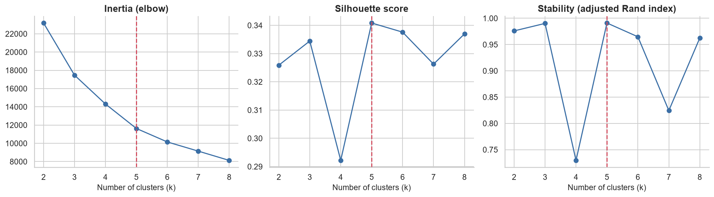
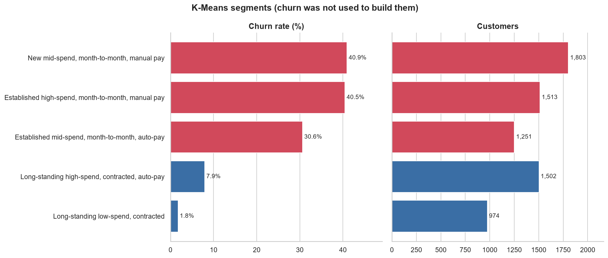
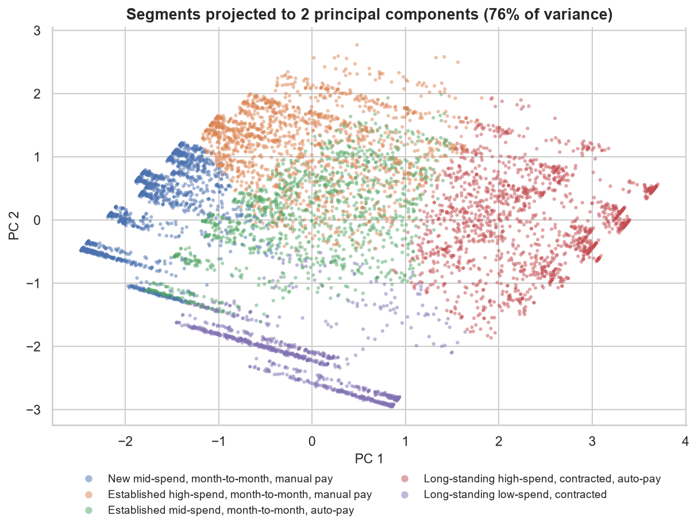

# Customer segmentation (K-Means)

_Generated by `python -m src.segmentation`; every number below was computed from the data._

## Method

* Inputs (standardised): tenure, monthly charges, number of add-on services, contract length (0/1/2) and automatic payment.
* **Churn is not an input.** Churn rates per segment are observed afterwards.
* k was evaluated from 2 to 8. Selection rule: highest silhouette among solutions with at least 3 clusters whose
  stability (mean adjusted Rand index across 10 refits on 80% subsamples) is at least 0.9.

| k | inertia | silhouette | stability_ari_mean | stability_ari_min |
|---|---|---|---|---|
| 2 | 23,184 | 0.326 | 0.976 | 0.951 |
| 3 | 17,469 | 0.334 | 0.990 | 0.978 |
| 4 | 14,310 | 0.292 | 0.730 | 0.477 |
| 5 | 11,626 | 0.341 | 0.991 | 0.979 |
| 6 | 10,150 | 0.338 | 0.965 | 0.905 |
| 7 | 9,145 | 0.326 | 0.824 | 0.779 |
| 8 | 8,129 | 0.337 | 0.962 | 0.829 |

**Chosen k = 5** (silhouette 0.341, stability 0.991). A silhouette of this size indicates **weak-to-moderate**
separation: the segments are useful summaries, not sharply distinct natural groups.

## Segments (ordered by churn rate; overall 26.5%)

| Segment | Customers | Churn rate | Share of churners | Avg tenure | Avg monthly | Add-ons | Month-to-month | Auto-pay | Active MRR |
|---|---|---|---|---|---|---|---|---|---|
| New mid-spend, month-to-month, manual pay | 1,803 | 40.9% | 39.5% | 8.6 | $47.72 | 0.6 | 90% | 0% | $43,311 |
| Established high-spend, month-to-month, manual pay | 1,513 | 40.5% | 32.7% | 30.3 | $86.45 | 2.9 | 74% | 0% | $74,770 |
| Established mid-spend, month-to-month, auto-pay | 1,251 | 30.6% | 20.5% | 23.7 | $66.34 | 1.8 | 86% | 100% | $54,745 |
| Long-standing high-spend, contracted, auto-pay | 1,502 | 7.9% | 6.4% | 61.4 | $88.61 | 4.4 | 4% | 82% | $121,417 |
| Long-standing low-spend, contracted | 974 | 1.8% | 0.9% | 45.8 | $23.82 | 0.2 | 0% | 60% | $22,743 |

The two-component projection retains 76% of the variance, so overlap in the picture overstates or understates separation to some extent.

## What this suggests

* **New mid-spend, month-to-month, manual pay** has the highest churn (40.9%) and holds 39% of all churners
  (1,803 customers, $43,311 active MRR): the first group to target.
* **Long-standing low-spend, contracted** has the lowest churn (1.8%): protect it, and avoid spending retention discounts here.

## Limitations

* K-Means assumes roughly round, similar-sized clusters and treats the ordinal contract and binary auto-pay inputs as numbers.
* Results depend on the chosen inputs; other reasonable inputs would give different segments.
* Segments describe a single snapshot and show association only.
