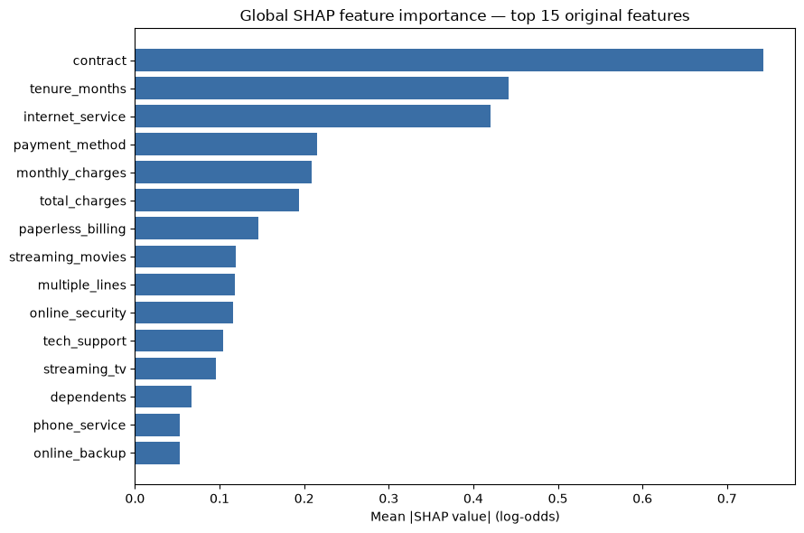
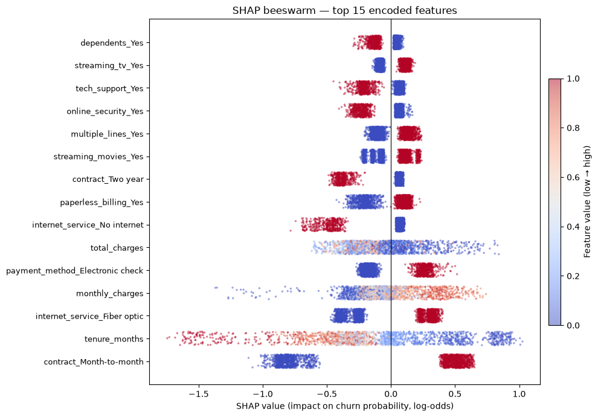

# SHAP global explanations (Phase 2, enhancement 3)

_Generated by `python -m src.explainability`; every number was computed from the data._

## Method

* `shap.TreeExplainer` on the fitted XGBoost champion pipeline.
* SHAP values are computed on the pre-processed (one-hot encoded) feature matrix using a sample of 2,000 customers.
* OHE sub-columns are **aggregated back to the original feature name** (sum of raw SHAP values) so results are human-readable.
* Mean absolute SHAP value across the sample is used as the importance measure.

## Global feature importance (top 15)

| feature | mean_abs_shap |
|---|---|
| contract | 0.7431 |
| tenure_months | 0.4412 |
| internet_service | 0.4204 |
| payment_method | 0.2156 |
| monthly_charges | 0.2092 |
| total_charges | 0.1941 |
| paperless_billing | 0.1462 |
| streaming_movies | 0.1187 |
| multiple_lines | 0.1182 |
| online_security | 0.1157 |
| tech_support | 0.1039 |
| streaming_tv | 0.0958 |
| dependents | 0.0666 |
| phone_service | 0.0528 |
| online_backup | 0.0525 |

## Interpretation

* **Higher = more influential on the model's churn-probability prediction** (regardless of direction).
* The sign of the SHAP value for a single customer tells whether that feature pushed the prediction up or down; mean |SHAP| averages this out across all customers.
* The beeswarm plot (``reports/figures/shap_02_beeswarm.png``) shows direction: red = high feature value, blue = low.

## Limitations

* SHAP explains the model, not the real world. A high SHAP importance means the model relies on that feature; it does not prove causation.
* The sample of 2,000 is used for speed; the full 7,043 would give essentially the same ranking.
* One-hot encoding means some original features are split across many sub-columns; the aggregation sums signed SHAP values, so cancellation can understate the true influence of categorical features with many categories.

